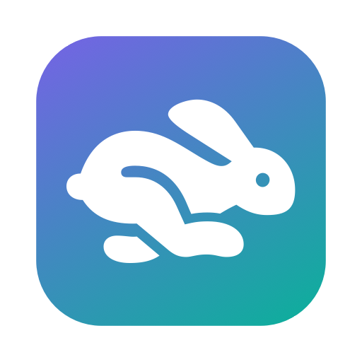
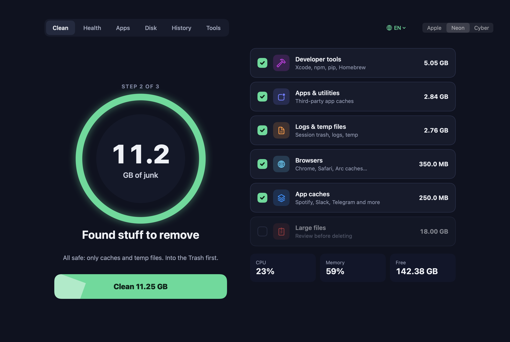
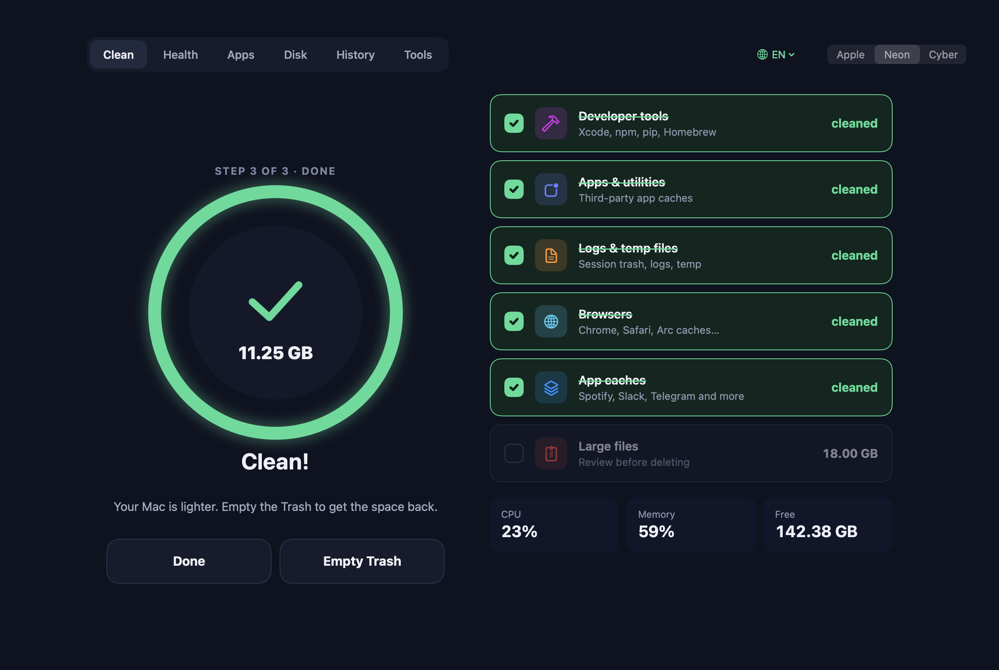
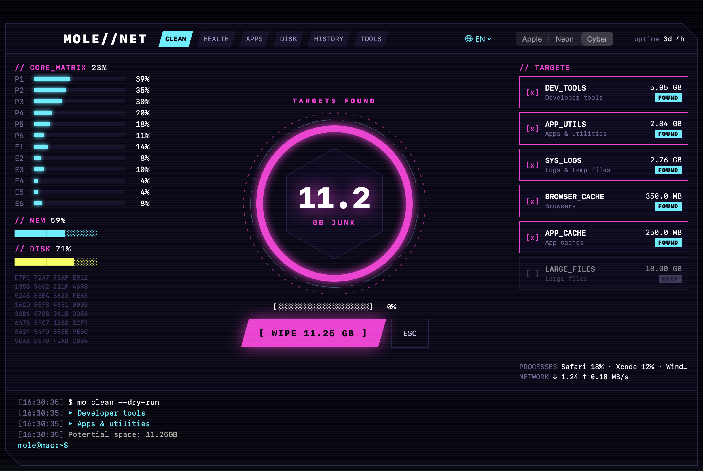
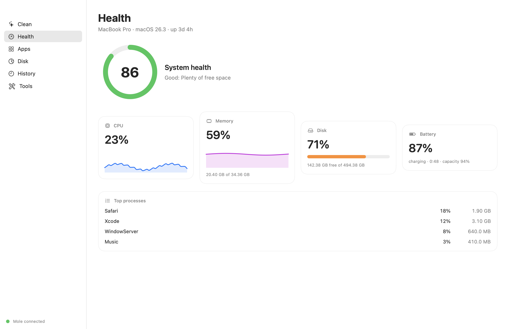
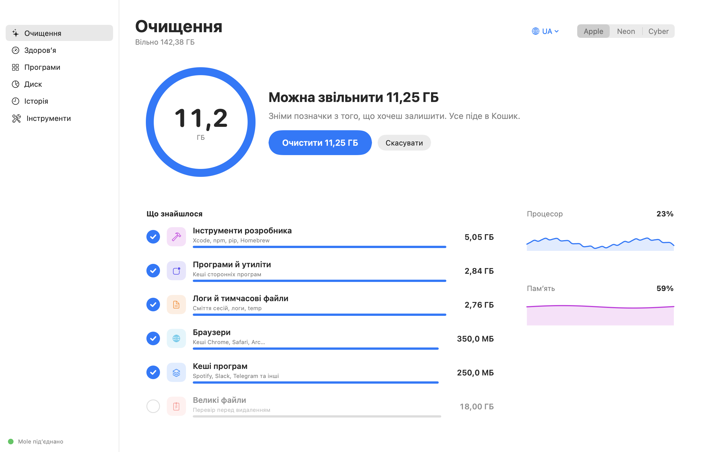
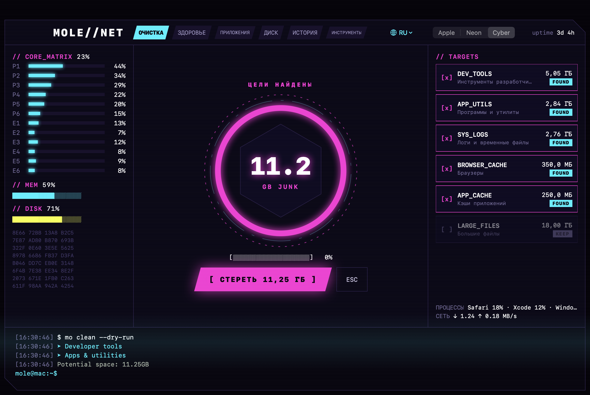
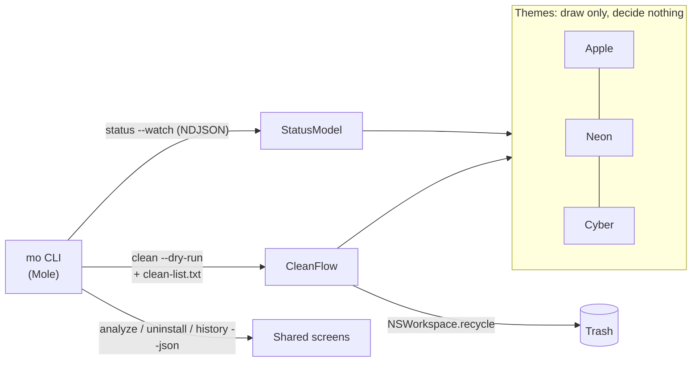

<div align="center">



# Mole UI

**A native macOS app for [Mole](https://github.com/tw93/mole): clean junk, watch system health and remove apps, with three switchable looks.**




</div>

---

## Three themes, one engine

| Apple — Liquid Glass | Neon — one big button | Cyber — terminal |
|:---:|:---:|:---:|
|  |  |  |
| Sidebar, glass cards, floating wallpaper, spring rings | Radar scan, pulse waves, particles flying into the orb | Live core matrix, glitch logo, scanlines, a real log |

Switch themes from the header or **Tools**. Your choice is remembered.

## What it does

| | |
|---|---|
| 🧹 **Clean** | Runs `mo clean --dry-run`, shows what can go by category, and lets you uncheck anything. Everything goes **to the Trash**, so you can still restore it. |
| 🩺 **Health** | Live CPU, memory, disk, battery and top processes from `mo status`, refreshed every 2 s. |
| 📦 **Apps** | Every installed app sorted by size. Uninstall through Mole together with its leftovers. |
| 💽 **Disk** | Click through folders to find what's eating space. Reveal in Finder or move to Trash. |
| 🕘 **History** | What Mole did and when. |
| 🧰 **Tools** | One-click Mole commands: full clean, optimize, old installers, Touch ID for sudo, update. |
| 🐇 **Menu bar** | Health at a glance plus a "Find junk" shortcut. |



## Install

You need **macOS 14 Sonoma or later**. The script installs everything else.

```bash
git clone https://github.com/Illia-Rahozin-Uni/mole-ui.git
cd mole-ui
bash install.sh
```

`install.sh` will:

1. install Apple's Command Line Tools if Swift is missing;
2. install Mole (`brew install mole`, or Mole's own installer if there's no Homebrew);
3. build the app, sign it ad-hoc and copy it to `~/Applications/Mole UI.app`;
4. launch it. Look for the 🐇 in the menu bar.

The app is built on your own Mac, so Gatekeeper won't warn you about an unidentified developer.

<details>
<summary><b>No git?</b></summary>

Click **Code → Download ZIP** on this page, unzip it, then:

```bash
cd ~/Downloads/mole-ui-main && bash install.sh
```
</details>

<details>
<summary><b>Update or uninstall</b></summary>

Update: `git pull && bash install.sh`

Uninstall: drag `~/Applications/Mole UI.app` to the Trash. Mole itself stays. Remove it with `brew uninstall mole` if you want.
</details>

## Languages

English, Українська and Русский. The app follows your system language, or you can pick one from the 🌐 menu in the header or in **Tools → Language**. Switching is instant, no restart needed.

| Українська | Русский |
|:---:|:---:|
|  |  |

## Is it safe?

- **Nothing is deleted on its own.** A scan is always a dry run, and the app moves only what you leave checked.
- **Trash, not `rm`.** Files go through `NSWorkspace.recycle`, the same as dragging them to the Trash yourself.
- **Your home folder only.** Paths outside `~`, whole `~/Library/<folder>` roots, and anything with `..` or wildcards are refused. Mole's system-level cleanup (which needs your password) only runs in Terminal, where you see every step.
- **Big or risky categories start unchecked:** large files, device backups, Time Machine, system caches.

## How it works



The themes contain no logic. All scanning, selection and byte counting lives in `CleanFlow`, so a new theme is just a new view. Infinite animations pause when the window is hidden, when the app is in the background with nothing running, or when **Reduce Motion** is on, so the app uses almost no CPU while idle.

More detail is in [docs/ARCHITECTURE.md](docs/ARCHITECTURE.md).

## Project layout

```
Sources/
  Core.swift           running mo, JSON models, StatusModel, CleanFlow
  App.swift            app entry, theme switching, shared screens, menu bar
  Localization.swift   EN / UA / RU strings and the language picker
  ThemeApple.swift     theme 1
  ThemeNeon.swift      theme 2
  ThemeCyber.swift     theme 3
tools/
  Snapshots.swift      renders README screenshots from the real views with demo data
  make_screenshots.sh
install.sh             one-command build and install
make_icon.swift        draws the app icon
```

There's no Xcode project, just `swiftc`. For a quick dev loop:

```bash
xcrun swiftc -parse-as-library -swift-version 5 -target arm64-apple-macos14.0 -o /tmp/MoleUI Sources/*.swift && /tmp/MoleUI
```

To regenerate screenshots: `bash tools/make_screenshots.sh`. They use demo data, never your own processes or paths. The Apple theme is rendered off-screen without its floating wallpaper and native sidebar.

## Credits

- [**Mole**](https://github.com/tw93/mole) by [tw93](https://github.com/tw93) does all the real work. This app is an unofficial front end and isn't affiliated with the Mole project. Mole is licensed under GPL-3.0 and is installed separately; this repo doesn't include any of its code.
- Built with SwiftUI and Swift Charts.

## License

[MIT](LICENSE)
